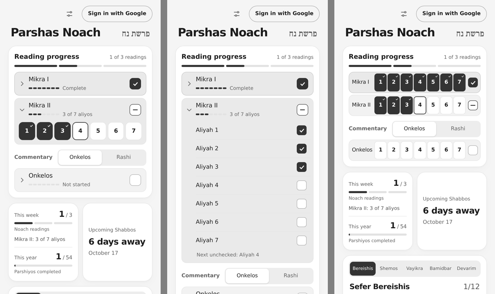

# Archived aliyah layouts

Two layouts that were tried on November 1, 2026 and not chosen. The app uses the
vertical checklist instead (middle in the image). Nothing here is imported, built, or
tested, and both layouts save progress in the same format as the app.



| Layout | Idea | Trade-off |
|---|---|---|
| Chips (left) | Folded rows that open to seven numbers on one line | Very compact, but aliyos appear only as numbers |
| Matrix (right) | No folding; one line per reading | Doesn't fold, and buttons are about 21px wide on a 320px screen |

## Restoring them

The steps add a `?aliyos=chips|matrix` URL option in `src/ui.js`. Anything else, or no
option, stays on the list.

1. Add this after the `dataset.checkboxLayout` line:

   ```js
   const requestedAliyahLayout = new URLSearchParams(location.search).get('aliyos');
   const aliyahLayout = ['chips', 'matrix'].includes(requestedAliyahLayout) ? requestedAliyahLayout : 'list';
   document.querySelector('#app').dataset.aliyahLayout = aliyahLayout;
   ```

2. In `readingRow`, replace `const open = expanded.has(reading);` with:

   ```js
   const matrix = aliyahLayout === 'matrix';
   const open = matrix || expanded.has(reading);
   ```

3. Also in `readingRow`, replace the `<button id="expand-${reading}" … </button>` line with:

   ```js
   ${matrix ? `<span class="expand-reading">${heading}</span>`
     : `<button id="expand-${reading}" type="button" class="expand-reading" data-expand="${reading}" aria-expanded="${open}" aria-controls="aliyos-${reading}" aria-label="${open ? 'Hide' : 'Show'} ${label} aliyos, ${status}">${chevron}${heading}</button>`}
   ```

4. Still in `readingRow`, in the aliyah button:
   - Change `aliyah-choice${on ? ' on' : ''}` to `aliyah-choice${on ? ' on' : ''}${index === next ? ' next' : ''}`.
   - Change `<span class="rlabel">Aliyah ${index + 1}</span>` to `<span class="rlabel"><span class="aliyah-word">Aliyah </span>${index + 1}</span>`.

5. Append [chips-and-matrix.css](chips-and-matrix.css) to the end of `src/style.css`.

6. To keep the browser check for them, add this to `tests/aliyah.spec.js`:

   ```js
   for (const layout of ['chips', 'matrix']) {
     test(`the ${layout} layout experiment saves the same progress and fits 320px`, async ({ page }) => {
       await page.setViewportSize({ width: 320, height: 800 });
       await page.goto(`/?aliyos=${layout}`);
       await expect(page.locator('#app')).toHaveAttribute('data-aliyah-layout', layout);
       if (layout === 'chips') await page.locator('#expand-mikra1').click();
       else await expect(page.locator('#expand-mikra1')).toHaveCount(0);
       await page.locator('#aliyah-mikra1-3').click();
       await expect(page.locator('#reading-mikra1')).toHaveAttribute('aria-checked', 'mixed');
       expect(await page.evaluate(() => JSON.parse(localStorage.getItem('shnaim-mikra-v1')).progress['5787:Noach'])).toEqual({ mikra1_4: true });
       expect(await page.evaluate(() => document.documentElement.scrollWidth <= innerWidth)).toBe(true);
       const heights = await page.locator('#aliyos-mikra1 button').evaluateAll(buttons => buttons.map(button => button.getBoundingClientRect().height));
       expect(heights.every(height => height >= 44)).toBe(true);
     });
   }
   ```
